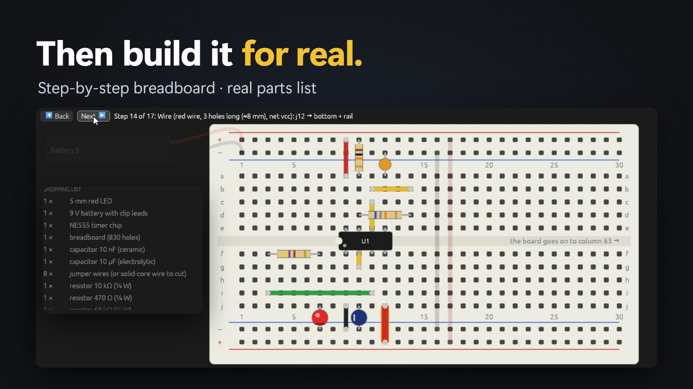

# Spark

A modern circuit simulator for Windows. Draw a circuit, run it, and see the voltages and
currents. Spark also has a lab bench (signal generator, power supply, scope), design
calculators, and an Academy of hands-on lessons for learning electronics.

[](https://codprog111.github.io/Spark-releases/media/spark-launch.mp4)

*Click the picture to watch the 20-second video.*

Spark is **free to use** and **closed source**. This repository holds only the releases; the
source code is not public.

## Download

Get the latest version from the **[Releases](../../releases/latest)** page:

- `Spark-<version>-setup.exe`: the installer (recommended). Installs for your user only, no
  admin rights needed, and uninstalls from Windows' *Installed apps* list.
- `Spark-<version>-windows-x64.zip`: the portable version. Unzip anywhere and run `Spark.exe`.

Needs 64-bit Windows 10 or 11.

### "Windows protected your PC"

Spark isn't code-signed yet, so Windows SmartScreen may warn you the first time. Click
**More info → Run anyway**. Only do this for files downloaded from this page.

### Checking your download

Each release lists SHA-256 checksums in `Spark-<version>-SHA256SUMS.txt`. In PowerShell:

```powershell
Get-FileHash .\Spark-<version>-setup.exe
```

The hash should match the line for that file.

## Problems and ideas

Open an [issue](../../issues). Please include the Spark version, what you did, and the circuit
file (`.spk` or `.cir`) if you can.

## License

Spark is free to use, including for commercial work. Redistributing, selling, modifying or
reverse engineering it is not allowed. See [LICENSE.txt](LICENSE.txt) for the full terms.
Spark is provided as is, without warranty: its results are simulations, so check a design
yourself before building it.

Spark uses open-source packages under their own licenses. They are listed with their full
texts in `THIRD-PARTY-LICENSES.html`, which comes with every download.
